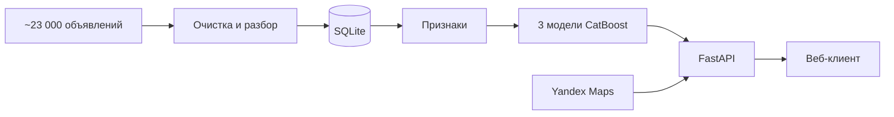

<div align="center">

# Estima

**Оценка рыночной стоимости квартиры, дома или участка в пару кликов**

Выберите адрес, укажите параметры, и модель машинного обучения оценит цену<br>по тысячам реальных объявлений о продаже

[](https://estima-frontend-six.vercel.app/)
[](https://estima-backend.onrender.com/docs)

[](https://github.com/welldanov/estima-backend/actions/workflows/ci.yml)


</div>


<sub>Бэкенд работает на бесплатном Render и засыпает без запросов, поэтому первая оценка может занять до минуты.</sub>

## Что умеет

- **Понимает адреса**: подсказки и геокодинг через Yandex Maps, как в привычных картах.
- **Два города**: Казань (квартиры) и Альметьевск (квартиры, дома, участки).
- **Честно говорит о точности**: если адрес на окраине или указан без номера дома, оценка помечается как приблизительная, а слишком далёкие адреса модель не оценивает вовсе.
- **Бережёт квоту**: суточный лимит запросов к Yandex не даёт сервису упереться в платный тариф.

## Насколько точно

В половине случаев оценка квартиры ошибается меньше чем на **7.7 %**. Для квартиры за 8 млн ₽ это около 600 тыс. ₽.

| | Объявлений в обучении | Ошибка модели | Ошибка «по средней цене м²» |
|---|---:|---:|---:|
| Квартиры | 18 506 | **7.7 %** | 18.9 % |
| Участки | 523 | **22.2 %** | 46.3 % |
| Дома | 431 | **31.8 %** | 34.4 % |

<sub>Медианная процентная ошибка на отложенной выборке. Дома и участки пока оцениваются грубее: объявлений по ним в десятки раз меньше.</sub>

## Как это работает



Самое интересное под капотом:

- **Чистые данные.** Заголовки объявлений разбираются по строгому формату, а доли, апартаменты, аукционы и квартиры «8 м² на 4 комнаты» отсекаются ещё на импорте.
- **Без утечек в оценке качества.** Переподанные объявления схлопываются в одно, а тестовая выборка делится по зданиям: квартиры одного дома не попадают одновременно в обучение и в проверку.
- **География как признак.** Учитываются расстояние до центра города и до ближайшей станции метро.
- **Модель не молчит об ошибках.** Несовместимая с кодом модель, незнакомый город или тип объекта дают явную ошибку, а не тихий неверный прогноз.

## Стек

| | |
|---|---|
| **Backend** |     |
| **ML** |     |
| **Данные** |   |
| **Инфраструктура** |       |

## Запустить у себя

<details>
<summary>Показать инструкцию</summary>

Нужны [uv](https://docs.astral.sh/uv/) и ключи Yandex Geosuggest и Geocoder.

```bash
uv sync
cp .env.example .env    # вписать ключи Yandex
uv run uvicorn estima_backend.api.main:app --reload
```

Swagger откроется на http://localhost:8000/docs.

Пересобрать базу и переобучить модели:

```bash
uv run python -m estima_backend.ingestion.importer data/raw/avito --rebuild
uv run python scripts/train.py
```

Тесты и линтеры (то же самое запускает CI на каждый pull request):

```bash
uv run ruff check .
uv run ruff format --check .
uv run mypy
uv run pytest
```

</details>
